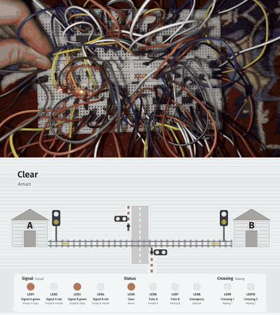
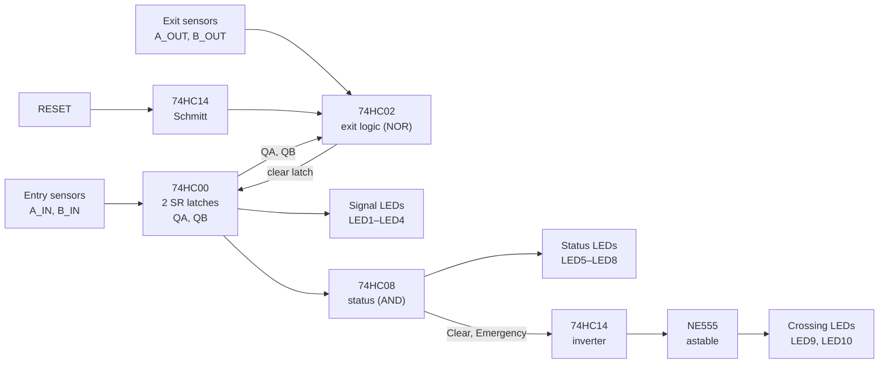
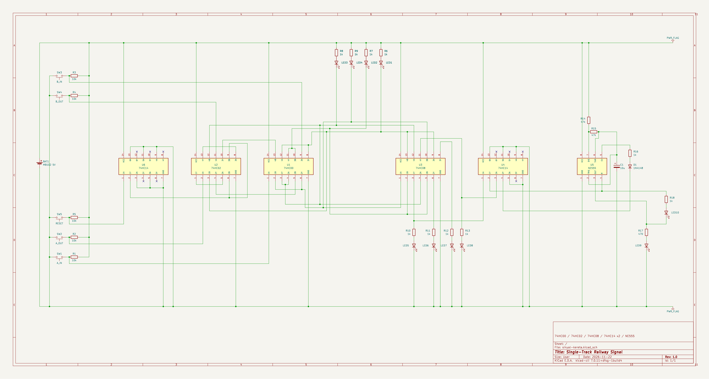
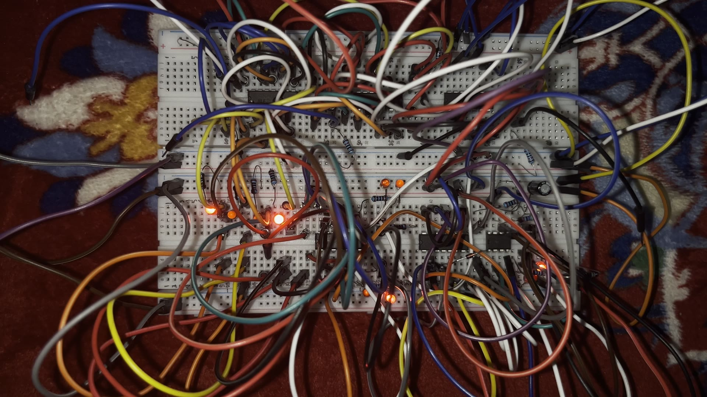

<h1>Single-Track Railway Signal</h1>

<b>Sinyal Kereta Jalur Tunggal</b>

A railway signal for a single-track line, built only from logic gate ICs and an NE555 on two breadboards. 
<i>Sinyal kereta untuk jalur tunggal, dibuat hanya dari IC gerbang logika dan NE555 di dua breadboard.</i>

Top: the real circuit · Bottom: animation synced to the same moments 
<i>Atas: rangkaian asli · Bawah: animasi yang disinkronkan</i>

<a href="media/demo.mp4"><b>▶ Full demo video (85 s)</b></a> &nbsp;·&nbsp;
<a href="https://kicanvas.org/?github=https://github.com/Rakutsann/sinyal-kereta-jalur-tunggal/blob/main/kicad/sinyal-kereta.kicad_sch"><b>View schematic in browser</b></a> &nbsp;·&nbsp;
<a href="kicad/"><b>KiCad files</b></a>

## Features · Fitur

- When train A enters, signal B turns red so no train is sent from B (and vice versa).
  *Saat kereta A masuk, sinyal B jadi merah supaya tidak ada kereta yang diberangkatkan dari B (begitu juga sebaliknya).*
- The exit sensor clears the track again.
  *Sensor keluar mengosongkan jalur kembali.*
- Level crossing lights blink alternately while a train is on the track.
  *Lampu palang perlintasan berkedip bergantian selama ada kereta di jalur.*
- If trains enter from both ends, the emergency LED lights up, both signals turn red, and the crossing blinks faster. Exit sensors are ignored until RESET is pressed.
  *Jika kereta masuk dari kedua ujung, LED darurat menyala, kedua sinyal merah, dan palang berkedip lebih cepat. Sensor keluar diabaikan sampai tombol RESET ditekan.*
- RESET returns everything to the clear state.
  *RESET mengembalikan semua ke kondisi aman.*

Sensors are simulated by touching jumper wires to the ground rail.
*Sensor disimulasikan dengan menyentuhkan kabel jumper ke rel ground.*

## How it works · Cara kerja

- **74HC00 (NAND):** two SR latches, one per track, remember whether train A (QA) or train B (QB) has entered.
  *Dua latch SR, satu per jalur, mengingat apakah kereta A (QA) atau kereta B (QB) sudah masuk.*
- **74HC02 (NOR):** the exit sensor or RESET clears the latch. The exit only works if the other track is not occupied.
  *Sensor keluar atau RESET membuka latch. Sensor keluar hanya berlaku kalau jalur lain tidak terisi.*
- **74HC14 (Schmitt inverter):** cleans the RESET signal and turns the status into enable signals for the NE555.
  *Merapikan sinyal RESET dan mengubah status menjadi sinyal pengaktif untuk NE555.*
- **74HC08 (AND):** decides the status: clear, train A, train B, or emergency (both latches set).
  *Menentukan status: aman, kereta A, kereta B, atau darurat (kedua latch aktif).*
- **NE555:** runs only when the track is not clear, blinking the crossing lights alternately. In emergency, a diode on the CV pin makes it blink faster.
  *Hanya berjalan saat jalur tidak aman, membuat lampu palang berkedip bergantian. Saat darurat, dioda di kaki CV membuat kedipnya lebih cepat.*

## LED roles · Peran LED

| LED | Role | Peran |
|---|---|---|
| LED1 | Signal A green | Sinyal A hijau |
| LED2 | Signal A red | Sinyal A merah |
| LED3 | Signal B green | Sinyal B hijau |
| LED4 | Signal B red | Sinyal B merah |
| LED5 | Clear | Aman |
| LED6 | Train A on track | Kereta A di jalur |
| LED7 | Train B on track | Kereta B di jalur |
| LED8 | Emergency | Darurat |
| LED9 | Crossing light 1 | Lampu palang 1 |
| LED10 | Crossing light 2 | Lampu palang 2 |

## Bill of materials · Daftar komponen

| Part | Qty | Note |
|---|---|---|
| 74HC00 (quad NAND) | 1 | U1 |
| 74HC02 (quad NOR) | 1 | U2 |
| 74HC08 (quad AND) | 1 | U3 |
| 74HC14 (hex Schmitt inverter) | 2 | U4, U6 |
| NE555 | 1 | U5 |
| Resistor 10 kΩ | 5 | R1–R5 (input pull-ups) |
| Resistor 1 kΩ | 11 | R6–R13, R16, R18 |
| Resistor 470 Ω | 1 | R17 |
| Resistor 47 kΩ | 2 | R14, R15 (NE555 timing) |
| Capacitor 10 µF | 1 | C1 |
| Diode 1N4148 | 1 | D1 |
| LED 5 mm | 10 | Any color · *warna bebas* (this build uses all red) |
| Breadboard 830 holes | 2 | |
| MB102 power module (5 V) | 1 | |
| Jumper wires | many | |

## Schematic · Skematik

Made in KiCad 7. Open [`kicad/sinyal-kereta.kicad_pro`](kicad/) in KiCad 7 or newer, or view it in the browser with [KiCanvas](https://kicanvas.org/?github=https://github.com/Rakutsann/sinyal-kereta-jalur-tunggal/blob/main/kicad/sinyal-kereta.kicad_sch). The IC symbols are drawn in physical DIP pin order (pins 1–7 bottom, 14–8 top), so the schematic reads the same way as the chip on the breadboard. The netlist exported from KiCad was checked against the breadboard wiring: all 37 nets match.
*Dibuat di KiCad 7. Buka [`kicad/sinyal-kereta.kicad_pro`](kicad/) di KiCad 7 atau lebih baru, atau lihat langsung di browser lewat [KiCanvas](https://kicanvas.org/?github=https://github.com/Rakutsann/sinyal-kereta-jalur-tunggal/blob/main/kicad/sinyal-kereta.kicad_sch). Simbol IC digambar sesuai urutan kaki fisik DIP (kaki 1–7 di bawah, 14–8 di atas), jadi skematiknya terbaca sama seperti chip di breadboard. Netlist hasil ekspor KiCad sudah dicocokkan dengan sambungan di breadboard: ke-37 jalurnya cocok.*

## Build · Hasil rakitan

The circuit was built and tested in stages, each with a visible result:
*Rangkaian dirakit dan diuji bertahap, masing-masing dengan hasil yang terlihat:*

1. **Stage 1:** NAND latch + signal LEDs · *latch NAND + LED sinyal*
2. **Stage 2a–2c:** exit logic (NOR) and reset · *logika keluar (NOR) dan reset*
3. **Stage 3:** status LEDs (AND) · *LED status (AND)*
4. **Stage 4a–4c:** emergency input, NE555 crossing blink, faster blink in emergency · *input darurat, kedip palang NE555, kedip lebih cepat saat darurat*

## Design note · Catatan desain

This is a simplified model: each signal shows the state of its own track lock. In real block signalling, signals at both ends turn red when the block is occupied.
*Ini model yang disederhanakan: setiap sinyal menunjukkan kunci jalurnya sendiri. Pada sistem blok kereta sungguhan, sinyal di kedua ujung menjadi merah saat blok terisi.*

## Credits and references · Kredit dan rujukan

- Circuit, schematic and demo video designed with the help of Claude (Anthropic AI). Built, debugged and tested by Rakutsann.
  *Rangkaian, skematik, dan video demo dirancang dengan bantuan Claude (AI dari Anthropic). Dirakit, di-debug, dan diuji oleh Rakutsann.*
- Standard building blocks: NAND SR latch, NOR gating, Schmitt inverters, NE555 astable.
- Datasheets: SN74HC00, SN74HC02, SN74HC08, SN74HC14, NE555 (Texas Instruments).
- Signal concept: [Signalling block system](https://en.wikipedia.org/wiki/Signalling_block_system) (Wikipedia).
- Schematic tool: [KiCad](https://www.kicad.org) · browser viewer: [KiCanvas](https://kicanvas.org).

## License · Lisensi

[MIT](LICENSE): free to use, modify and share, including commercially, as long as the copyright notice is kept.
*Bebas dipakai, diubah, dan dibagikan, termasuk untuk komersial, asal keterangan hak cipta tetap dicantumkan.*
